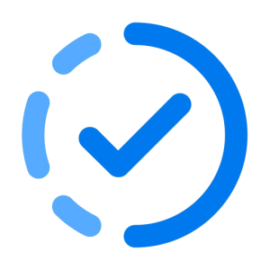

# Due This Week

**A free, private to-do sidebar for Canvas LMS, built for Microsoft Edge.**

Ever had trouble finding your weekly assignments? Due This Week adds a clean to-do list and progress chart to your Canvas dashboard, so you can see everything due this week at a glance. It also works with Blackboard and D2L Brightspace.

> **Unofficial.** Due This Week is not affiliated with, endorsed by, or sponsored by Instructure, Inc. (Canvas), Anthology (Blackboard), or D2L. "Canvas" is a trademark of Instructure, Inc.

## Privacy
- **No accounts, no tracking, no analytics.**
- The extension only talks to **your school's own LMS**, using the login you already have in your browser. Your assignments never leave your computer.
- Settings are saved in your browser's extension storage.

## Download
Coming soon to **Microsoft Edge Add-ons**. Until then, you can [install it from source](#installing-and-running-for-development).

## Features

### Stay on track
Colorful task items make sure you never miss an assignment again.

### Track your progress
Progress bars for each course show how much of this week's work you've finished.

### Make it your own
Task items and progress bars follow your Canvas dashboard colors and course order. You can add your own custom tasks too.

### Notes
- The sidebar works on the Canvas dashboard in Card View, List View, and Recent Activity.
- Only courses with assignments appear in the chart. You can choose to show all dashboard courses on the Settings page.
  - To change your dashboard courses, go to **Courses → All Courses** in Canvas and star the classes you want.
- The **Unfinished** list shows assignments from your dashboard courses that are unsubmitted and either ungraded or graded 0.
- Custom tasks made with the original Tasks for Canvas extension still show up.

## Installing and running for development

1. Install [Node.js](https://nodejs.org/) 16 or newer. Development has been tested on Node 25.
2. Clone this repository.
3. Run `npm ci` to install the exact dependency versions.
4. Run `npm run build` to build once, or `npm start` to rebuild automatically as you edit.
5. **Edge:** go to `edge://extensions`, turn on **Developer mode**, click **Load unpacked**, and select the `build` folder.
   **Chrome:** same steps at `chrome://extensions`.
   **Firefox:** run `npm run firefox`, go to `about:debugging` → **This Firefox** → **Load Temporary Add-on**, and choose `build/manifest.json`.
6. Run `npm test` to run the test suite.

To regenerate the icons after changing the design, run `python3 utils/make-icons.py`.

Found a bug or have an idea? [Open an issue](https://github.com/samfrazier/due-this-week/issues).

## Credits
Due This Week is a fork of **[Tasks for Canvas](https://github.com/UseBetterCanvas/canvas-task-extension)** by **Jeff Cheng** and its contributors, released under the MIT License. Thank you for building the original. 💙

Changes in this fork:
- Removed the remote A/B-testing config, the per-user client ID, and the install/uninstall tracking URLs
- New name and icon, and support links now go to this repo
- System fonts instead of Google Fonts, so the extension pages load nothing from other servers
- Packaged for Microsoft Edge Add-ons

Originally built with [Chrome Extension Boilerplate with React 17 and Webpack 5](https://github.com/lxieyang/chrome-extension-boilerplate-react.git).

## License
[MIT](LICENSE). The original copyright notice is kept as the license requires.
